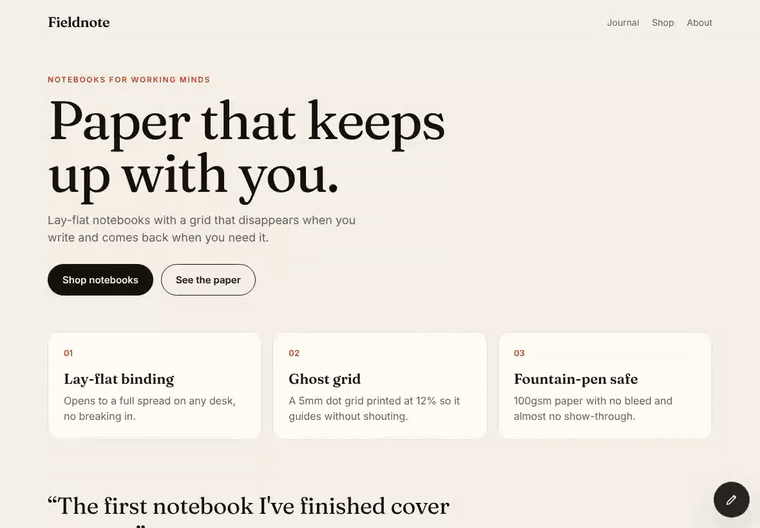
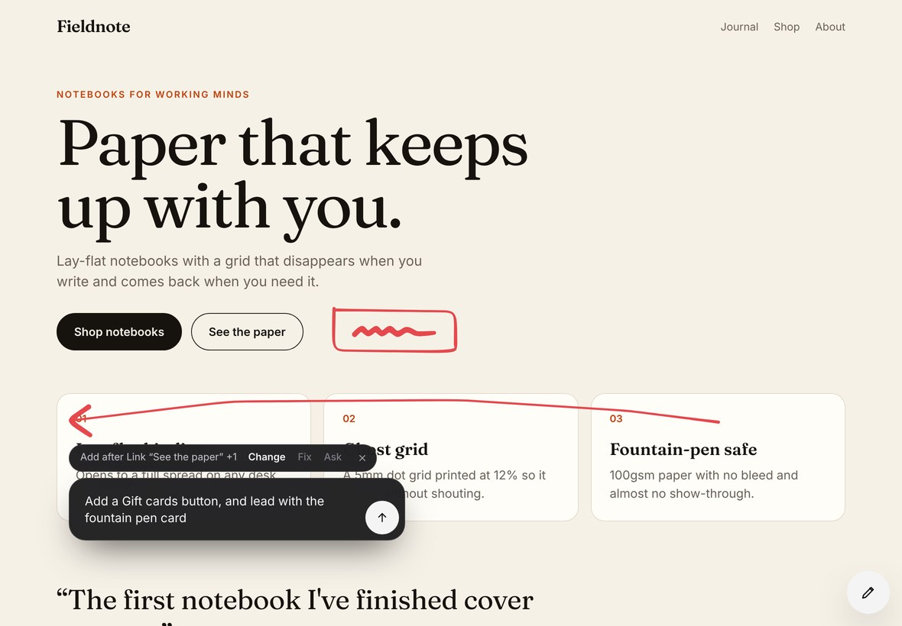
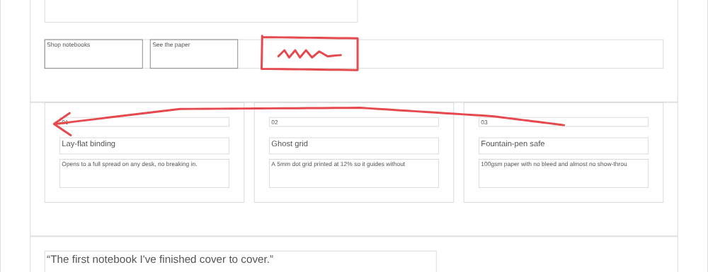

<h1 align="center">✎ Pencil Agent</h1>

<p align="center"><b>Circle it on your iPad. Say what's wrong. Claude Code fixes it on your Mac.</b></p>

<p align="center"><a href="https://pencil.reallygood.work">pencil.reallygood.work</a></p>

<p align="center">
  
  
  
  
</p>

<p align="center">
  
</p>

You notice most problems while you're looking at the real thing, usually on a phone or iPad. The fix is small: a colour, a word, some spacing. But making it means opening the laptop, finding the file and losing the thread. So it waits, or it gets lost.

Pencil Agent lets you review like a creative director instead. Walk the site, mark it up, keep going. A coding agent on your Mac makes each change, and the page updates in front of you.

```
iPad / iPhone                          your Mac
─────────────                          ─────────────────────────────────────────
your dev site + overlay   ──HTTPS──▶   pencil server (127.0.0.1:4545)
  ✎ circle + note                        │  waits, costs nothing while idle
  ● → ● → ✓  live         ◀─────────     └─▶ Claude Code edits your repo
                       private, over Tailscale
```

## Try it in 30 seconds

No Tailscale, no config. On a Mac with Node and [Claude Code](https://claude.com/claude-code):

```bash
git clone https://github.com/reallygoodwork/pencil && cd pencil
npm run demo              # real Claude Code edits a scratch copy
npm run demo -- --fake    # scripted agent, no tokens: knows two notes only (it prints them)
```

Open http://localhost:5173, tap the pen, circle something, and send a note. The demo edits a scratch copy of a sample site, never your files.

**On your phone or iPad:** add `--lan` (same Wi-Fi, plain HTTP) and scan the QR code it prints, or type the short `your-mac.local` address. `--tailscale` gives HTTPS, so the mic button works. Add it to your Home Screen and next time it's one tap.

## Sketch it, don't spell it

Draw the way you'd mark up a printout. Pencil Agent reads the shape and turns it into an instruction.

| You draw | It means |
|---|---|
| ◯ &nbsp;a circle | change this |
| → &nbsp;an arrow from one thing to a spot | move it there, a whole card, not just its heading |
| □ &nbsp;a box in empty space, with a scribble inside | add something like this, here |
| ✕ &nbsp;an X, or a line through something | remove it |
| ＿ &nbsp;an underline | make it stand out |
| ✎ &nbsp;anything else | a shape to build, read from the picture |

It doesn't try to recognise drawings. It measures each stroke: do the ends meet, do the points hug a box, does the pen turn back at the tip. Loose rules like that hold up in anyone's hand. Before you send, the note tells you how it read you ("Add after Link 'See the paper'"). Claude also gets a picture of the page as outlines with your ink on top, so a misread mark still lands.

<p align="center">
  
  
</p>
<p align="center"><sub>What you draw · what Claude receives</sub></p>

## What it's like to use

- **Pencil draws, fingers scroll.** On an iPad your hand never fights the tool. On a phone, turn the pen on, draw with one finger and scroll with two. The pen turns itself off after you send, and **Clear** wipes a stray mark.
- **Pause to finish.** Draw as many marks as you like. Stop for under a second and a small pill opens: type, talk, or just send the sketch.
- **Keep moving.** A numbered marker sits on what you marked: amber waiting, blue working, purple a question for you, green done. Mark the next thing while Claude works on the last one.
- **Circle, wait, check, done.** When it's finished, the marker turns to a green check with Claude's one-line answer. Tap it to drag between before and after.
- **Talk for free.** Use the dictation key on your keyboard, or turn on a mic button that transcribes on your Mac with whisper.cpp. No paid speech service, and the audio never leaves home.
- **Tidy up.** A tray lists every note. Close, reopen, or delete with five seconds to undo.

## Set it up for real (about 10 minutes)

You need a Mac with **Node 20.6+**, **Claude Code** signed in, your app's **dev server**, and **[Tailscale](https://tailscale.com)** (free) on the Mac and your iPad or iPhone.

**1. Get the code and share your Mac with your devices**
```bash
git clone https://github.com/reallygoodwork/pencil && cd pencil
tailscale serve --bg --https=443  http://localhost:5173   # your app (use your dev port)
tailscale serve --bg --https=8443 http://127.0.0.1:4545   # pencil
```
First time with Tailscale? [docs/tailscale.md](docs/tailscale.md) walks through it.

**2. Point it at your project**
```bash
cp pencil.env.example pencil.env
```
```bash
APP_ORIGIN=https://your-mac.your-tailnet.ts.net        # your app, as the iPad sees it
PUBLIC_URL=https://your-mac.your-tailnet.ts.net:8443   # pencil, as the iPad sees it
PROJECT_DIR=/Users/you/code/your-app                   # the only repo Claude may edit
```

**3. Start it and add the overlay to your app (dev only)**
```bash
npm start
```
Vite and Next.js take a few lines: see **[docs/frameworks.md](docs/frameworks.md)**. Anything else: `npm run tag` prints a script tag. No code changes at all: `npm run bookmarklet`.

**4. Open your app on the iPad and draw.** That's it.

## Three ways to run the agent

| Mode | Start with | Who makes the change | Cost while idle |
|---|---|---|---|
| **Headless** (default) | `npm start` | A fresh `claude -p` run per batch of notes | nothing |
| **Relay** | `npm run relay`, then `/pencil-relay` in Claude Code | The session you already have open, with all its context | nothing |
| **MCP** | `node server.js --mcp` | Your open session, through MCP tools | a little, every few minutes |

**Relay** is the one to try if you're mid-build. Install the command once with `npm run install-relay`, then run `/pencil-relay` in a session in your project. It starts one background shell that sleeps until a note lands, wakes the session, makes the change, answers on the note and goes back to sleep. Notes go back to the session that took them, so two sessions in one repo each see only their own threads.

## What Claude sees

Words, not screenshots. Each note becomes a short brief, about 60 tokens:

```
[ann_c6j7hqC0Cmk] fix: Make this our brand orange
page: /
element: a.btn.btn-primary "Shop notebooks"
source: src/components/PrimaryButton.tsx:12
classes: btn btn-primary
image: …/9f2a.png (720×440), pin at (156, 220): crop around that point. Optional.
seen: …/955c.html (sha256 3b1f0c9a27de): the element's HTML as the user saw it.
```

The picture and the snapshot are there if Claude needs them, and cost nothing if it doesn't. Notes sent within two seconds go in one run, so Claude explores your code once. Tip: a short `CLAUDE.md` in your project ("components live in src/components") saves it even more digging.

## Private by design

This lets a web page ask an agent to edit files on your Mac, so the whole design is about who can reach it.

- **Your Mac only.** The server listens on `127.0.0.1`. Your iPad gets in through Tailscale, a private network only your own devices can join.
- **A secret token** on every request, stored in `~/.pencil-agent/token`, readable only by you. The server never prints it unless you ask.
- **Your app only.** Requests must come from your app's exact origin and name an allowed host, so no other website can talk to it through your browser.
- **A limited agent.** Claude gets file tools only: read, find, search, edit, write. No terminal, no internet, nothing outside your project.
- **Dev only.** Never ship the overlay to production. The framework setups make sure of it.

Full details: [docs/reference.md](docs/reference.md#security).

## Day-to-day

| You want to… | Do this |
|---|---|
| Send several changes at once | Mark and send a few in a row. Anything within about 2 seconds goes in one run. |
| Ask instead of change | Pick **Ask** above the note. Claude answers without editing anything. |
| Follow up or correct it | Tap the marker and reply. The note reopens and goes back to Claude. |
| See every note | Tap the tray next to the pen. **Open** and **Done** tabs; tap a note to jump to it. |
| Hide the markers | The eye in the tray. |
| Close, reopen, delete | On the note or in the tray. Close keeps the history. Delete gives you 5 seconds to undo. |

Write notes like you'd brief a developer: "make this the brand orange and 20% smaller" beats "fix this".

## Troubleshooting

| Symptom | Fix |
|---|---|
| `origin not allowed` | `APP_ORIGIN` must match the address bar exactly: scheme, host and port, no trailing slash. |
| `bad token` | The tag or bookmarklet is stale. Run `npm run tag` or `npm run bookmarklet` again. |
| No pen button | Open `PUBLIC_URL/health` on the device. If your app has a Content Security Policy, allow `PUBLIC_URL` in `script-src` and `connect-src` in dev. |
| `502` from Tailscale | Is the dev server running? Use the full `http://localhost:PORT` form. See [docs/tailscale.md](docs/tailscale.md#troubleshooting). |
| Vite blocks the host | Add `server.allowedHosts: ['.ts.net']`. See [docs/frameworks.md](docs/frameworks.md#vite). |
| The Pencil scrolls instead of drawing | The pen is off. Tap it so it lights up. |
| Marker goes green, page doesn't change | Hot reload isn't reaching the device. See [docs/frameworks.md](docs/frameworks.md) or add `data-reload="true"` to the script tag. |
| Marker goes purple: "I couldn't finish this" | Check the server's terminal, then reply on the note to retry. |
| `claude: not found` | Set `CLAUDE_BIN=/full/path/to/claude` in `pencil.env`. |
| `Port 4545 is in use` | Another Pencil is running, or set `PORT=` and update `tailscale serve` to match. |

## Docs

- **[docs/tailscale.md](docs/tailscale.md)**: private HTTPS from your phone or iPad, and the same-Wi-Fi option without it
- **[docs/frameworks.md](docs/frameworks.md)**: Vite, Next.js, everything else, and the bookmarklet
- **[docs/reference.md](docs/reference.md)**: config, commands, the brief, the AFS data model, HTTP and agent APIs, voice, security

**Hosting the landing page:** `site/` is plain static files. On Vercel, import the repo as is: `vercel.json` serves `site/` and nothing else. The Pencil server itself never goes on a host; it refuses to start there.

## What's in here

```
server.js            the server: one file, no dependencies
overlay.js           the drawing overlay your page loads
bin/pencil.js        relay client for a Claude Code session
templates/           the /pencil-relay command
docs/                setup guides and reference
examples/demo-app/   the sample site for the demo
site/                the landing page
test/                npm test
```

## Credits

- Annotations follow the [Agentation Annotation Format Schema v1.1](https://agentation.com/schema). This is an independent implementation with no Agentation code.
- Ink by [perfect-freehand](https://github.com/steveruizok/perfect-freehand) from Steve Ruiz (MIT), vendored in `vendor/`.
- Type on the landing page: [Paper Mono](https://github.com/paper-design/paper-mono) (OFL).

## License

**MIT.** Use it for anything: personal, client work, commercial. Change it, ship it, sell it. Just keep the credit: the copyright line in [LICENSE](LICENSE) stays in your copy. A shout-out to [@reallygoodwork](https://x.com/reallygoodwork) is appreciated, not required.

<p align="center">Made by <a href="https://reallygood.work">Really Good Work Inc.</a> · <a href="https://x.com/reallygoodwork">@reallygoodwork</a><br>© 2026 Drew Minns</p>
